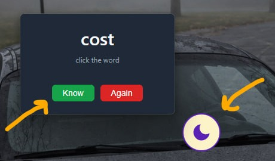

# English

**English** is a tiny always-on-top desktop widget that teaches vocabulary one word at a time. It was built for a beginner (A0) who works in IT: a word pops up every 15 minutes (or every hour in the "hourly" build), you tap *Know* or *Again*, and it gets out of the way.
Words come back on a **spaced-repetition** schedule (a check after 7 days), and phrasal verbs unlock only after you know their base verb.
A moon button gives you "do not disturb" in one click. Runs on **Windows** and **Mac**, fully **offline**: no account, no internet connection needed.

[](https://github.com/aiiadu-ai/dad-english/releases/latest)

---

## Як завантажити й встановити

Нижче все українською, покроково: що відкрити, що натиснути.

### Крок 1. Відкрий сторінку з програмою

Найпростіше: відкрий **[сторінку Releases](https://github.com/aiiadu-ai/dad-english/releases)**
(або натисни зелену кнопку **Download** вище: вона відкриває звичайну версію).

Якщо шукаєш вручну: на головній сторінці репозиторію подивись на **праву колонку** (під блоком **About**) і
**прокрути її вниз**: після рядків «Readme», «Activity», «stars», «watching», «forks» буде заголовок **Releases**.
Натисни на назву релізу під ним. Окремої вкладки «Releases» угорі немає.

### Крок 2. Обери версію

На сторінці **Releases** є кілька релізів. Тобі потрібен один із **двох найновіших**. Вони однакові,
відрізняється лише те, як часто з'являється слово:

| Версія | Як часто слово | Як її впізнати |
|---|---|---|
| **Звичайна** | кожні **15 хвилин** | реліз із зеленою позначкою **Latest** (наприклад, `v1.0.2`) |
| **На 1 годину** | раз на **1 годину** | реліз «…версія з паузою 1 година» з позначкою **Pre-release** (наприклад, `v1.0.2-hourly`) |

Старіші релізи (`v1.0.0`, `v1.0.1`) не потрібні: вони застарілі.

### Крок 3. Завантаж один файл

На сторінці обраного релізу прокрути вниз до розділу **Assets** (Файли) і натисни **один** файл:

- **Mac:** файл, що закінчується на `-universal.dmg`
- **Windows:** файл, що закінчується на `-win-x64.zip`

Інші рядки там (наприклад, «Source code») не потрібні. Файл збережеться в папку **Завантаження** (Downloads).

### Крок 4a. Встановлення на Mac

Програма не підписана Apple, тому macOS попросить дозволу при першому запуску.

1. Відкрий завантажений файл `.dmg` (двічі клікни на ньому).
2. Перетягни значок **English** у папку **Applications** (Програми).
3. Відкрий English із папки Applications. macOS скаже, що не може перевірити програму, — натисни **«Готово»**.
4. Відкрий **Системні налаштування → Конфіденційність і безпека**, прокрути вниз до повідомлення про English і
   натисни **«Все одно відкрити»**. Підтверди паролем Mac.
5. Далі програма запускатиметься без запитань.

**Якщо macOS пише, що програма «пошкоджена»** — відкрий Термінал і виконай:

```bash
xattr -cr /Applications/English.app
```

Після цього відкрий English ще раз.

Автозапуск разом із Mac закладений у програмі, але на справжньому Mac його ще не перевіряли.

### Крок 4b. Встановлення на Windows

1. Клацни на завантаженому `.zip` правою кнопкою миші → **«Видобути все»** (Extract all) у **постійну папку**
   (наприклад, `C:\Programs\English` або на робочий стіл). Не запускай прямо з архіву й не переноси
   папку потім: автозапуск запам'ятовує, де лежить програма.
2. Відкрий папку й двічі клікни **`English.exe`**.
3. Якщо Windows пише **«Windows protected your PC»**: натисни **«Докладніше»** → **«Все одно виконати»**.

Після першого запуску програма відкриватиметься сама разом із Windows. Вимкнути це можна, змінивши
`"autostart": true` на `false` у файлі `resources\app\config.json` і один раз запустивши програму.

---

## How it's built

**Stack.** [Electron](https://www.electronjs.org/) 33 with plain JavaScript, HTML and CSS, no frameworks:
a widget with 200 words doesn't need them. Tests use Node's built-in runner (`node --test`). The apps are
packaged with [electron-builder](https://www.electron.build/) and built automatically by GitHub Actions.

**Spaced repetition.** A word goes through a simple cycle:
`new` → Know → `waits 7 days` → review → Know → `learned for good`. Again at any step
sends the word to a repeat queue and the cycle starts over. Scheduling rules:
- words whose week has passed are shown before new ones;
- a word from the repeat queue comes back after every 5 new words;
- phrases (`go on`, `come back`) unlock only after Know on their base verb (`go`, `come`),
  a "base first, derived second" dependency.

All of this logic lives in a separate module, `learning.js`, which doesn't depend on Electron, so it can be
checked with fast automated tests (`npm test`, 28 tests) without opening any windows.

**Hourly quiz.** Once per clock hour, at a random minute, a separate window asks for the translation of a
Ukrainian word with four English options. Wrong options are picked so that only one answer can be right
(no shared Ukrainian meaning, same part of speech), a wrong answer sends the word back to the repeat queue,
and words already learned are asked only rarely. The quiz logic (`quiz.js`) is just as independent of Electron.

**Reliability in the details.** Progress is saved after every answer; a corrupted or old progress file is never
overwritten, it is set aside instead; a second copy of the app can't be started; the app launches together with
the computer; test settings live in a separate file that doesn't end up in the build.

**GitHub Actions builds for Mac and Windows.** A Mac app can't be built on Windows, so GitHub does it all:
one workflow ([`build.yml`](.github/workflows/build.yml)) builds a universal `.dmg` (Intel + Apple Silicon)
on `macos-latest` and a `.zip` for Windows on `windows-latest` for every version, runs the tests before building,
and on a `v*` tag publishes both files on the [Releases](https://github.com/aiiadu-ai/dad-english/releases) page.

**Made with Claude Code.** The author is not a programmer and is learning vibe coding: the project was built
in pair with [Claude Code](https://claude.com/claude-code), Anthropic's AI coding assistant.
The author set the requirements, made the decisions and checked the results; Claude Code wrote the code,
the tests and the build setup.

---

## Як це працює

1. Через певну **паузу** з'являється **англійське слово**: **15 хвилин** у звичайній версії, **1 година** у версії «на 1 годину».
2. Клік по слову показує **український переклад** (ще клік — повертає англійське).
3. Кнопки **Know** (знаю) і **Again** (ще раз). Після кліку віджет ховається до наступного слова.
4. **Know** → слово ховається на **7 днів**. Через тиждень воно повертається на перевірку:
   - **Know** ще раз → слово вивчене назавжди;
   - **Again** → слово йде в чергу повторів, і все починається спочатку.
5. **Again** у будь-який момент → слово повертається після кожних 5 нових слів.
   Слова, в яких минув тиждень, показуються раніше за нові.
6. **Конструкції** (`go on`, `come back`, `make sure`…) з'являються лише після того, як на їхньому
   базовому дієслові (`go`, `come`, `make`) хоч раз натиснули Know.
7. Іконка 🌙 внизу завжди на екрані: клік вмикає **«не турбувати»** (слова не з'являються 2 години),
   ще клік — вимикає. Іконку можна перетягнути в зручне місце.

Програма відкривається сама разом із комп'ютером (автозапуск), а прогрес зберігається у файлі й не губиться.

### Тест (раз на годину)

Раз на годину, у **випадковий момент**, окреме вікно (ліворуч від віджета зі словом) показує
**українське слово** і **4 англійські варіанти**. Натисни правильний.

- Правильна відповідь стає зеленою, неправильна червоною (правильна теж підсвічується), і через 2 секунди вікно ховається.
- Вікно **не зникає саме**: воно висить, поки не відповіси (щоб не пропустити його на другому екрані).
  Якщо не відповіла, за годину з'явиться нове питання, і воно замінить старе.
- Рівно **один тест у кожну годину** (наприклад, о 14:23, потім о 15:48). Під час «не турбувати» тест не з'являється.
- Питання беруться лише зі слів, які вже показували. **Вивчені** слова (двічі Know) трапляються рідко:
  в середньому одне на 17 питань, решта питань про слова, які ще вчаться.
- Слова йдуть **по черзі**, а не навмання: спершу ті, які тест ще не питав, потім ті, що питав найдавніше.
  Тому слово не повториться, поки не пройдуть усі інші.
- **Правильна відповідь** ставить слово в кінець черги тесту, на розклад вивчення не впливає.
  **Помилка** відправляє слово в **Again** (чергу повторів), і тест незабаром спитає його знову.
- Неправильні варіанти того ж типу (іменник до іменників) і ніколи не мають такого самого українського
  перекладу, що й питання (наприклад, `customer` і `client` — обидва «клієнт», тож разом не потраплять).

### Коли з'являється наступне слово

«Пауза» нижче — це 15 хвилин у звичайній версії й 1 година у версії «на 1 годину». Її можна змінити
в `config.json` (`intervalMs`, `dndMs`).

| Що сталося | Коли буде наступне слово |
|---|---|
| Програму щойно запустили (або ввімкнули комп'ютер, якщо працює автозапуск) | **одразу**: одне слово показується при старті |
| Натиснули **Know** або **Again** | через **паузу** |
| Клікнули 🌙, щоб увімкнути «не турбувати» | слово ховається, наступне прийде **само рівно через 2 години** після кліку |
| Клікнули 🌙 ще раз, щоб вимкнути «не турбувати» | через **паузу** після цього кліку, а не одразу |
| Клікнули 🌙, поки слово ще на екрані | слово ховається без відповіді (ні Know, ні Again), далі як у «не турбувати» |
| Усі слова вивчені або чекають перевірки | нічого не з'являється; програма перевіряє знову через кожну паузу, і слово повернеться, коли мине 7 днів |

Поки комп'ютер вимкнений, слова не з'являються.

### Чи потрібен інтернет

**Ні, програма працює повністю без інтернету.** Усі слова, переклади й прогрес лежать на самому
комп'ютері (`words.json` і `progress.json`), а в коді програми немає жодних звернень до мережі:
вона нічого нікуди не надсилає й не потребує облікового запису. Інтернет потрібен лише один раз, щоб
завантажити файл програми зі сторінки Releases, а далі його можна вимкнути.

## Запуск локально (для розробки)

Потрібен [Node.js](https://nodejs.org/) 20 або новіший.

```bash
npm install
npm start
```

На Windows у PowerShell команду `npm` може заблокувати політика скриптів — тоді використовуй
`npm.cmd start`.

Перевірка логіки вивчення:

```bash
npm test
```

### Тестовий режим

Щоб не чекати 15 хвилин і 7 днів, створи файл `config.local.json` (він не потрапляє в git):

```json
{ "testMode": true }
```

У тестовому режимі беруться слова з `words.test.json` (12 слів), слово з'являється кожні 5 секунд,
а «тиждень» триває 40 секунд. Прогрес тестового режиму пишеться в окремий `progress.test.json`.
Щоб побачити на віджеті підпис (NEW / REVIEW / AGAIN), додай `"showTestLabel": true`.

## Налаштування (`config.json`)

| Поле | Що означає | За замовчуванням |
|---|---|---|
| `intervalMs` | пауза між словами, мілісекунди | `900000` (15 хв); у версії «на 1 годину» — `3600000` (1 год) |
| `dndMs` | скільки триває «не турбувати» | `7200000` (2 год) |
| `reviewDays` | через скільки днів перевірка після першого Know | `7` |
| `autostart` | відкривати апку разом із комп'ютером | `true` |
| `testMode` | тестовий режим (див. вище) | `false` |
| `testIntervalMs`, `testReviewSeconds` | швидкі інтервали тестового режиму | `5000`, `40` |
| `quizEnabled` | чи показувати тест раз на годину | `true` |
| `quizEveryHours` | один тест на стільки годин (1 — раз на годину, 2 — раз на дві) | `1`; у версії «на 1 годину» — `2` |
| `quizLearnedEvery` | у середньому одне питання з вивчених слів на стільки питань | `17` |
| `quizTestIntervalMs` | пауза між тестами в тестовому режимі | `8000` |

`config.local.json` перекриває окремі поля `config.json`.

## Як додати слова (`words.json`)

Файл — це масив слів. Приклад:

```json
[
  {
    "en": "deadline",
    "uk": "дедлайн, кінцевий термін",
    "type": "noun",
    "examples": [{ "en": "The deadline is Friday.", "uk": "Дедлайн — у п'ятницю." }]
  },
  {
    "en": "go on",
    "uk": "продовжувати",
    "type": "phrase",
    "base": "go",
    "examples": [{ "en": "Please, go on.", "uk": "Продовжуйте, будь ласка." }]
  }
]
```

- `en` — слово англійською, `uk` — переклад.
- `type` — `noun` (іменник), `verb` (дієслово) або `phrase` (конструкція). Можна й інші типи
  (наприклад, `adjective`, `adverb`): вони працюють як звичайні слова.
- `base` — **лише для `phrase`**: дієслово, після Know на якому відкриється конструкція
  (наприклад, для `go on` це `go`). Таке дієслово (`type: "verb"`) має бути в списку.
- `examples` — приклади речень (поки не показуються, це наступний етап).
- Пара `en` + `type` має бути унікальною (`call` як іменник і `call` як дієслово — це різні слова).

Після зміни слів запусти `npm test`. У вже встановленій програмі `words.json` лежить:
- Windows: `resources\app\words.json` у папці програми;
- Mac: `English.app` → правою кнопкою «Показати вміст пакета» → `Contents/Resources/app/words.json`.

## Де зберігається прогрес

- Windows: `%APPDATA%\dad-english\progress.json`
- Mac: `~/Library/Application Support/dad-english/progress.json`

Щоб почати вивчення спочатку, закрий програму й видали цей файл.

## Як випустити нову версію

Збірки робить GitHub Actions (файл `.github/workflows/build.yml`), бо Mac-програму на Windows не зібрати.

- **Перевірка без публікації:** вкладка **Actions** → **Build** → **Run workflow**. Обидві збірки
  з'являться внизу запуску в розділі **Artifacts**.
- **Публікація:** змінити `"version"` у `package.json`, закомітити, створити тег виду `v1.0.1`
  й запушити його. Збірка запуститься сама, а за кілька хвилин на сторінці Releases з'являться обидва файли.
- **Версія «на 1 годину»:** окрема гілка `hourly` (там `intervalMs = 3600000`) і тег виду `v1.0.2-hourly`.
  Такий реліз виходить як **Pre-release**, тому не стає «Latest», і кнопка «Download» веде на звичайну версію.

## Структура проєкту

| Файл | Призначення |
|---|---|
| `main.js` | вікна, таймери, збереження прогресу |
| `learning.js` | уся логіка вибору слів (тестується окремо) |
| `learning.test.js` | автотести логіки |
| `quiz.js`, `quiz.test.js` | логіка тесту (питання, варіанти, розклад) і її автотести |
| `index.html`, `style.css`, `renderer.js`, `preload.js` | віджет зі словом |
| `quiz.html`, `quiz-renderer.js` | вікно тесту |
| `moon.html` | іконка 🌙 |
| `words.json` | 200 слів |
| `words.test.json` | 12 слів для тестового режиму |
| `.github/workflows/build.yml` | автоматична збірка для Windows і Mac |
| `docs/widget.jpg` | скріншот віджета для README |
