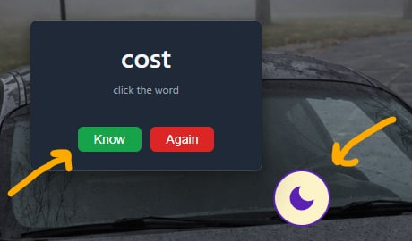

<p align="center">
  
</p>

# English

**English** is a tiny always-on-top desktop widget that teaches vocabulary one word at a time. It was built for a beginner (A0) who works in IT: a word pops up every 50 minutes, you tap *Know* or *Again*, and it gets out of the way.
Words come back on a **spaced-repetition** schedule (a check after 7 days), and phrasal verbs unlock only after you know their base verb.
A moon button gives you "do not disturb" in one click. Runs on **Windows** and **Mac**.

<p align="center">
  <a href="https://github.com/aiiadu-ai/dad-english/releases/latest">
    
  </a>
</p>

---

## Як зроблено

**Стек.** [Electron](https://www.electronjs.org/) 33 і звичайні JavaScript, HTML та CSS, без фреймворків:
для віджета на 200 слів вони не потрібні. Автотести — вбудований у Node `node --test`. Збірка програм —
[electron-builder](https://www.electron.build/), автоматизація — GitHub Actions.

**Інтервальне повторення (spaced repetition).** Слово проходить простий цикл:
`нове` → Know → `чекає 7 днів` → перевірка → Know → `вивчене назавжди`. Again на будь-якому кроці
відправляє слово в чергу повторів і цикл починається спочатку. Правила розкладу:
- слова, в яких минув тиждень, показуються раніше за нові;
- слово з черги повторів повертається після кожних 5 нових слів;
- конструкції (`go on`, `come back`) відкриваються лише після Know на базовому дієслові (`go`, `come`),
  це залежність «спершу основа, потім похідне».

Уся ця логіка живе в окремому модулі `learning.js` без Electron, тому її можна перевіряти швидкими
автотестами (`npm test`, 13 тестів), не запускаючи вікна.

**Надійність у дрібницях.** Прогрес зберігається після кожної відповіді, пошкоджений або старий файл
прогресу не перезаписується, а відкладається убік; друга копія програми не запускається; програма сама
відкривається разом із комп'ютером; тестові налаштування лежать в окремому файлі, який не потрапляє в збірку.

**Збірка на GitHub Actions для Mac і Windows.** Mac-програму на Windows не зібрати, тому все робить
GitHub: один workflow ([`build.yml`](.github/workflows/build.yml)) на кожну версію збирає
універсальний `.dmg` (Intel + Apple Silicon) на `macos-latest` і `.zip` для Windows на `windows-latest`,
перед збіркою проганяє тести, а на тег `v*` публікує обидва файли на сторінці
[Releases](https://github.com/aiiadu-ai/dad-english/releases).

**Зроблено з Claude Code.** Автор не програміст і вчиться вайбкодингу: проєкт зроблено в парі з
[Claude Code](https://claude.com/claude-code), ШІ-асистентом для програмування від Anthropic.
Автор ставив вимоги, ухвалював рішення й перевіряв результат, а Claude Code писав код, тести та збірку.

---

## Як це працює

1. Раз на 50 хвилин з'являється **англійське слово**.
2. Клік по слову показує **український переклад** (ще клік — повертає англійське).
3. Кнопки **Know** (знаю) і **Again** (ще раз). Після кліку віджет ховається до наступного слова.
4. **Know** → слово ховається на **7 днів**. Через тиждень воно повертається на перевірку:
   - **Know** ще раз → слово вивчене назавжди;
   - **Again** → слово йде в чергу повторів, і все починається спочатку.
5. **Again** у будь-який момент → слово повертається після кожних 5 нових слів.
   Слова, в яких минув тиждень, показуються раніше за нові.
6. **Конструкції** (`go on`, `come back`, `make sure`…) з'являються лише після того, як на їхньому
   базовому дієслові (`go`, `come`, `make`) хоч раз натиснули Know.
7. Іконка 🌙 внизу завжди на екрані: клік вмикає **«не турбувати»** (слова не з'являються 2 години),
   ще клік — вимикає. Іконку можна перетягнути в зручне місце.

Апка запускається сама разом із комп'ютером, а прогрес зберігається у файлі й не губиться.

## Завантажити

Готові програми лежать на сторінці **[Releases](https://github.com/aiiadu-ai/dad-english/releases/latest)**.
Відкрий найновіший реліз і завантаж файл для своєї системи:

| Система | Файл |
|---|---|
| Windows 10/11 | `English-…-win-x64.zip` |
| Mac (Intel і Apple Silicon) | `English-…-universal.dmg` |

Програми не підписані, тому система при першому запуску попросить підтвердження — нижче описано, як.

## Встановлення на Windows

1. Завантаж `English-…-win-x64.zip`.
2. Клацни на ньому правою кнопкою → **«Видобути все»** (Extract all) у **постійну папку**
   (наприклад, `C:\Programs\English` або на робочий стіл). Не запускай прямо з архіву й не переноси
   папку потім: автозапуск запам'ятовує, де лежить програма.
3. Відкрий папку й двічі клікни **`English.exe`**.
4. Якщо Windows пише **«Windows protected your PC»**: натисни **«Докладніше»** → **«Все одно виконати»**.

Після першого запуску програма відкриватиметься сама разом із Windows. Вимкнути це можна, змінивши
`"autostart": true` на `false` у файлі `resources\app\config.json` і один раз запустивши програму.

## Встановлення на Mac

Для татового Mac. Програма не підписана Apple, тому macOS попросить дозволу при першому запуску.

1. Завантаж `English-….dmg` і відкрий його.
2. Перетягни **English** у папку **Applications** (Програми).
3. Відкрий English з Applications. macOS скаже, що не може перевірити програму, — натисни **«Готово»**.
4. Відкрий **Системні налаштування → Конфіденційність і безпека**, прокрути вниз до повідомлення про
   English і натисни **«Все одно відкрити»**. Підтверди паролем Mac.
5. Далі програма запускатиметься без запитань.

**Якщо macOS пише, що програма «пошкоджена»** — відкрий Термінал і виконай:

```bash
xattr -cr /Applications/English.app
```

Після цього відкрий English ще раз.

## Запуск локально (для розробки)

Потрібен [Node.js](https://nodejs.org/) 20 або новіший.

```bash
npm install
npm start
```

На Windows у PowerShell команду `npm` може заблокувати політика скриптів — тоді використовуй
`npm.cmd start`.

Перевірка логіки вивчення:

```bash
npm test
```

### Тестовий режим

Щоб не чекати 50 хвилин і 7 днів, створи файл `config.local.json` (він не потрапляє в git):

```json
{ "testMode": true }
```

У тестовому режимі беруться слова з `words.test.json` (12 слів), слово з'являється кожні 5 секунд,
а «тиждень» триває 40 секунд. Прогрес тестового режиму пишеться в окремий `progress.test.json`.
Щоб побачити на віджеті підпис (NEW / REVIEW / AGAIN), додай `"showTestLabel": true`.

## Налаштування (`config.json`)

| Поле | Що означає | За замовчуванням |
|---|---|---|
| `intervalMs` | пауза між словами, мілісекунди | `3000000` (50 хв) |
| `dndMs` | скільки триває «не турбувати» | `7200000` (2 год) |
| `reviewDays` | через скільки днів перевірка після першого Know | `7` |
| `autostart` | відкривати апку разом із комп'ютером | `true` |
| `testMode` | тестовий режим (див. вище) | `false` |
| `testIntervalMs`, `testReviewSeconds` | швидкі інтервали тестового режиму | `5000`, `40` |

`config.local.json` перекриває окремі поля `config.json`.

## Як додати слова (`words.json`)

Файл — це масив слів. Приклад:

```json
[
  {
    "en": "deadline",
    "uk": "дедлайн, кінцевий термін",
    "type": "noun",
    "examples": [{ "en": "The deadline is Friday.", "uk": "Дедлайн — у п'ятницю." }]
  },
  {
    "en": "go on",
    "uk": "продовжувати",
    "type": "phrase",
    "base": "go",
    "examples": [{ "en": "Please, go on.", "uk": "Продовжуйте, будь ласка." }]
  }
]
```

- `en` — слово англійською, `uk` — переклад.
- `type` — `noun` (іменник), `verb` (дієслово) або `phrase` (конструкція).
- `base` — **лише для `phrase`**: дієслово, після Know на якому відкриється конструкція
  (наприклад, для `go on` це `go`). Таке дієслово (`type: "verb"`) має бути в списку.
- `examples` — приклади речень (поки не показуються, це наступний етап).
- Пара `en` + `type` має бути унікальною (`call` як іменник і `call` як дієслово — це різні слова).

Після зміни слів запусти `npm test`. У вже встановленій програмі `words.json` лежить:
- Windows: `resources\app\words.json` у папці програми;
- Mac: `English.app` → правою кнопкою «Показати вміст пакета» → `Contents/Resources/app/words.json`.

## Де зберігається прогрес

- Windows: `%APPDATA%\dad-english\progress.json`
- Mac: `~/Library/Application Support/dad-english/progress.json`

Щоб почати вивчення спочатку, закрий програму й видали цей файл.

## Як випустити нову версію

Збірки робить GitHub Actions (файл `.github/workflows/build.yml`), бо Mac-програму на Windows не зібрати.

- **Перевірка без публікації:** вкладка **Actions** → **Build** → **Run workflow**. Обидві збірки
  з'являться внизу запуску в розділі **Artifacts**.
- **Публікація:** змінити `"version"` у `package.json`, закомітити, створити тег виду `v1.0.1`
  й запушити його. Збірка запуститься сама, а за кілька хвилин на сторінці Releases з'являться обидва файли.

## Структура проєкту

| Файл | Призначення |
|---|---|
| `main.js` | вікна, таймери, збереження прогресу |
| `learning.js` | уся логіка вибору слів (тестується окремо) |
| `learning.test.js` | автотести логіки |
| `index.html`, `style.css`, `renderer.js`, `preload.js` | віджет зі словом |
| `moon.html` | іконка 🌙 |
| `words.json` | 200 слів |
| `words.test.json` | 12 слів для тестового режиму |
| `.github/workflows/build.yml` | автоматична збірка для Windows і Mac |
| `docs/widget.jpg` | скріншот віджета для README |
